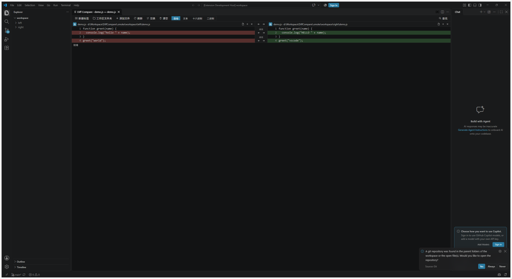

# Diff Compare for VS Code

在 VS Code 里开一个 **左右两栏的对比标签页**，把文件、目录
（或别的编辑器标签页）拖进去直接比较，并且**在每一处差异上就地同步**。


- 编辑器标题栏右上角有一枚 **Diff / Compare** 小角标，点一下就开出一个对比标签页；
- 标签页左右两栏，可以把**文件、目录、其它标签页**直接**拖进左栏或右栏**；
- 也可以在**资源管理器**或**文件标签页**上点右键 → **Diff Compare**，
  选择**加入 / 替换第 N 个对比标签的左栏或右栏**（可以同时开好几个对比标签页）；
- 同类型才比较：文件 ↔ 文件、目录 ↔ 目录；
- **每一处差异**旁边都有一对 **← →** 箭头：
  - **←** 把右侧同一位置的修改**同步回左侧**；
  - **→** 把左侧同一位置的修改**同步到右侧**；
- 目录也能逐条同步（只在一侧存在的文件、两边都存在但内容不同的文件）；
- **十六进制 / 二进制**文件打开时自动识别，顶部工具栏可随时切换 **文本 / 十六进制 / 二进制** 视图；
- `Ctrl+F` 在两侧同时搜索并高亮所有匹配项，`Enter` / `Shift+Enter` / `F3` 逐个跳转。



---

## 目录

- [快速上手](#快速上手)
- [界面说明](#界面说明)
- [右键菜单：加进第 N 个对比标签](#右键菜单加进第-n-个对比标签)
- [拖拽：把什么丢进哪一栏](#拖拽把什么丢进哪一栏)
- [视图模式](#视图模式)
- [同步规则](#同步规则)
- [搜索](#搜索)
- [深链：直接打开指定的两侧](#深链直接打开指定的两侧)
- [工作区之外的文件（访问策略）](#工作区之外的文件访问策略)
- [设置项](#设置项)
- [命令一览](#命令一览)
- [安装与构建](#安装与构建)
- [日志](#日志)
- [已知的边界](#已知的边界)
- [目录结构](#目录结构)
- [许可与再分发](#许可与再分发)

---

## 快速上手

1. 装好扩展后，在任意编辑器里点右上角的 **Diff / Compare** 角标（或命令面板里
   **Diff Compare: 打开对比视图**）——会开出一个新的对比标签页；
2. 点工具栏的 **工作区文件夹**，把当前工作区的第一个文件夹放进左栏；再点一次
   **添加文件**（或从资源管理器里拖）把右栏填上；
   —— 也可以更省事：在资源管理器里右键某个文件 → **Diff Compare** → 选
   **加入左侧 / 加入右侧**（或者直接选已有的第 N 个对比标签页）；
3. 两栏自动开始比较。文本文件显示逐行差异，目录显示文件树差异，
   二进制文件自动进入十六进制视图；
4. 在每一处差异上点 **←** 或 **→**，把这一处改动同步到另一侧。

> 拖拽支持三种来源：**资源管理器里的文件/目录**、**打开的编辑器标签页**、
> **从别的窗口拖过来的文件**。
> 不想拖拽就用右键菜单，能力完全一样。

---

## 界面说明

```
┌──────────────────────────────────────────────────────────────┐
│ [▯▯ 新建标签] [工作区文件夹] [添加文件] [⟳ 刷新] [⇄ 交换] [🗑 清空]  自动 文本 十六进制 二进制  [🔍 查找] │
├───────────────┬───────────────────┬───────────────────────────┤
│ 左栏标题      │  ← → 差异操作区   │ 右栏标题                  │
├───────────────┼───────────────────┼───────────────────────────┤
│ 1  line one   │                   │ 1  line one               │
│ 2  line two   │      ←            │ 2  line TWO   ← 改这里    │
│ 3  line three │      →            │ 3  line three             │
├───────────────┴───────────────────┴───────────────────────────┤
│ 状态栏：共 3 处差异 · 视图：文本 · 查找：2/5                  │
└──────────────────────────────────────────────────────────────┘
```

| 区域 | 说明 |
| --- | --- |
| 工具栏 | 新建标签 / 添加工作区文件夹 / 添加文件 / 刷新 / 交换左右 / 清空；视图模式切换（自动·文本·十六进制·二进制）；查找 |
| 栏标题 | 显示当前这一侧的文件或目录名，右侧三个小按钮：**用当前编辑器**、**选文件/目录**、**清除这一侧** |
| 差异操作区 | 每处差异一行一对箭头：**←** 右侧→左侧，**→** 左侧→右侧 |
| 状态栏 | 差异数量、当前视图模式、查找命中数 |
| 查找栏 | `Ctrl+F` 唤出；两侧同时高亮，`Enter`/`Shift+Enter`/`F3` 跳转，`Esc` 关闭 |

两栏**滚动联动**，一行一行地对齐。
中间那一列顶部有 **全部同步到左侧 / 全部同步到右侧** 两个按钮，作用在整份差异上。
工具栏的 **刷新** 会重新读取两侧内容再比较一次（外部改了文件之后点它即可）。
工具栏的 **新建标签** 会再开一个空白的对比标签页，可以同时比较好几组内容。

---

## 右键菜单：加进第 N 个对比标签

不想拖拽时，直接在**资源管理器里的文件/目录**上，或者在**文件标签页**上点右键，
会出现一行 **Diff Compare**。点开它会弹出一个选择列表：

```
新建对比标签
  加入左侧        新建一个对比标签并放入左栏
  加入右侧        新建一个对比标签并放入右栏
─────────────────────────────
第 1 个标签 · a.js ↔ b.js
  加入左侧 / 加入右侧 / 替换左侧 / 替换右侧
第 2 个标签 · （空）
  加入左侧 / 加入右侧 / 替换左侧 / 替换右侧
```

- **加入**：如果那一栏已经有内容，会再问一次——**替换该栏**、**新建标签**、**取消**；
- **替换**：直接覆盖那一栏，不再询问；
- 列表里会列出**当前打开的所有对比标签页**（按打开顺序编号），
  没有打开任何对比标签页时，选前两项即可直接新建；
- 对比标签页的标题会显示成 `Diff Compare · 左名 ↔ 右名`，方便区分。

> 右键菜单同样适用于**目录**：把目录加进去就是目录比较。

---

## 拖拽：把什么丢进哪一栏

| 拖进来的东西 | 结果 |
| --- | --- |
| 资源管理器里的**文件** | 放进那一栏，与另一栏比较 |
| 资源管理器里的**目录** | 放进那一栏，与另一栏比较目录结构 |
| 已打开的**编辑器标签页** | 把该标签页对应的文件放进那一栏 |
| 从系统文件管理器拖进来的路径 | 放进那一栏（会先过一遍访问策略，见下文） |

往**左栏**丢 → 进左侧；往**右栏**丢 → 进右侧。拖到哪一栏就落到哪一栏。

---

## 视图模式

打开文件时会自动判断内容类型：

- **文本**（UTF-8 / UTF-16 带 BOM 或不带）→ 逐行 diff；
- **二进制**（含 NUL 字节，或不是合法 UTF-8）→ 自动进入**十六进制**视图。

顶部工具栏可以随时切换：

| 模式 | 说明 |
| --- | --- |
| **自动** | 按内容自动选文本或十六进制（默认） |
| **文本** | 强制按文本比较；二进制文件会给出提示并仍以十六进制显示 |
| **十六进制** | 16 字节一行的 hex dump，两侧按**偏移对齐**，不同的字节高亮 |
| **二进制** | 汇总成"字节差异区间"表格，每段区间配一对箭头 |

`diffCompare.defaultViewMode` 可以把默认模式改成 `text` / `hex` / `binary`。

---

## 同步规则

同步的粒度是**"一处差异"**——不是整篇覆盖。

### 文本

- **←**：把右侧这一处改动**写回左侧**，左侧其它行保持不动；
- **→**：把左侧这一处改动**写回右侧**；
- 两侧同时存在却内容不同 → 一对箭头；
- 只有一侧有内容（新增/删除）→ 只有能"补上"的那一侧有箭头：
  左侧缺 → **→**（把左侧这段复制到右侧）；右侧缺 → **←**。

> **删除类操作会二次确认。** 当同步会**删掉**另一侧已有的行时，
> 扩展会弹窗说明"将删除 N 行"，确认后才落盘。

### 目录

目录比较会列出相对路径级别的差异，每条给出可用的箭头：

| 差异 | ←（右侧→左侧） | →（左侧→右侧） |
| --- | --- | --- |
| 只有右侧有 | 复制到左侧 | — |
| 只有左侧有 | — | 复制到右侧 |
| 两边都有但内容不同 | 用右侧覆盖左侧 | 用左侧覆盖右侧 |
| 两边都一样 | — | — |

中间那一列顶部还有 **全部同步到左侧 / 全部同步到右侧**，一次性处理所有差异
（同样会先弹窗确认，再逐条写入）。

### 二进制

按字节差异区间同步：区间内的字节用一侧的**原始字节**覆盖另一侧，
区间外的字节保持不动。

---

## 搜索

`Ctrl+F`（macOS 为 `Cmd+F`）在对比标签页里唤出查找栏：

- **两侧同时搜索**，所有命中用 `<mark>` 高亮；
- 状态栏显示 `第 n / 共 m 个匹配`；
- `Enter` 跳到下一个匹配，`Shift+Enter` 跳到上一个，`F3` 同 `Enter`；
- `Esc` 关闭查找栏。

---

## 深链：直接打开指定的两侧

扩展注册了 `vscode://Aurumjin.diff-compare/open` 深链，可以从脚本、书签或
其它扩展直接打开指定的两侧内容：

```
vscode://Aurumjin.diff-compare/open?left=<左侧路径>&right=<右侧路径>
```

- 两侧可以是**文件**（逐行 / 十六进制比较），也可以是**目录**（目录比较）；
- 路径可以写**绝对路径**，也可以写相对于当前工作区的路径；
- 路径仍然要过一遍[访问策略](#工作区之外的文件访问策略)；
- 路径含空格或特殊字符时，用标准的百分号编码（`%20` 等）即可。

例子（Windows）：

```
code --open-url "vscode://Aurumjin.diff-compare/open?left=D%3A%5Cproj%5Ca.js&right=D%3A%5Cproj%5Cb.js"
```

例子（macOS / Linux）：

```
code --open-url "vscode://Aurumjin.diff-compare/open?left=/home/me/proj/a.js&right=/home/me/proj/b.js"
```

---

## 工作区之外的文件（访问策略）

> **结论：默认只允许比较当前工作区里的路径；越界时按需询问一次，而不是一刀切禁止。**

这是刻意的折中：

- 一刀切禁止会**限制用户**——比如临时想比一下 `D:\Downloads\a.zip` 和项目里的构建产物，
  只能先把文件复制进工作区，很别扭；
- 一律放行又**不安全**——工作区信任模型的前提是"扩展只碰你打开的项目"。

所以扩展采取**默认收紧、按需放宽**：

1. 路径在当前工作区里 → 直接放行；
2. 路径在工作区外 →
   - 工作区处于**不受信任**状态 → **直接拒绝**（不弹窗）；
   - 设置项 `diffCompare.allowOutsideWorkspace` 为 `true` → 直接放行；
   - 否则弹一次提示，给出四个选项：
     - **仅本次允许** —— 只在本次会话里生效（重开 VS Code 即失效）；
     - **始终允许此路径** —— 记住这个路径，之后不再问；
     - **允许所有外部路径** —— 相当于把 `diffCompare.allowOutsideWorkspace` 打开；
     - **取消** —— 拒绝加入这一栏。

授权记录存在扩展的 globalState 里，**不会**写进工作区的 `.vscode/settings.json`，
因此不会污染你的项目。

> **同步写操作**永远只发生在**已经加入某一栏的那个文件**上，
> 不会凭空写工作区之外的路径：加入时没授权的路径，根本进不来。

---

## 设置项

| 键 | 默认值 | 说明 |
| --- | --- | --- |
| `diffCompare.allowOutsideWorkspace` | `false` | 允许比较工作区之外的路径。`true` 时不再询问；不受信任的工作区无论如何都拒绝外部路径 |
| `diffCompare.exclude` | `["**/node_modules/**", "**/.git/**", "**/.hg/**", "**/.svn/**"]` | 目录比较时忽略的路径（glob） |
| `diffCompare.maxFileSize` | `32` | 单文件大小上限（MB）。超过该大小的文件不比较内容：目录对比只比较文件大小，单文件对比会给出提示 |
| `diffCompare.defaultViewMode` | `"auto"` | 默认视图模式：`auto` / `text` / `hex` / `binary` |

---

## 命令一览

命令面板里搜 `Diff Compare`：

| 命令 | 作用 |
| --- | --- |
| `Diff Compare: 打开对比视图` | 打开（或聚焦）对比标签页 |
| `Diff Compare: 新建对比标签` | 再开一个空白的对比标签页 |
| `Diff Compare: 添加当前工作区文件夹` | 把当前工作区文件夹加到某一栏 |
| `Diff Compare: 选择要比较的文件…` | 弹出文件选择器 |
| `Diff Compare: 交换左右` | 交换两栏内容 |
| `Diff Compare: 清空` | 清空两栏 |
| `Diff Compare: 把当前编辑器加入左侧` | 把当前打开的文件放进左栏 |
| `Diff Compare: 把当前编辑器加入右侧` | 把当前打开的文件放进右栏 |
| `Diff Compare: 全部同步到左侧` | 所有差异都用右侧覆盖左侧 |
| `Diff Compare: 全部同步到右侧` | 所有差异都用左侧覆盖右侧 |
| `Diff Compare: 查找` | 唤出查找栏（`Ctrl+F`） |
| `Diff Compare: 显示日志` | 打开输出面板 |

另外在**资源管理器**和**编辑器标题栏的右键菜单**里有一行 **Diff Compare**，
点开可以选择加入 / 替换第 N 个对比标签页的左栏或右栏（见上文）。

---

## 安装与构建

**从商店安装**：<https://marketplace.visualstudio.com/items?itemName=Aurumjin.diff-compare>

```
扩展面板 → 搜索 "Diff Compare" → 安装
```

命令行：

```bash
code --install-extension Aurumjin.diff-compare
```

**从 GitHub 下载**：仓库的 *Releases* 页挂着打包好的 `.vsix`，
见 <https://github.com/Aujin/diff-compare/releases>。

本地构建：

```bash
npm install          # 只装依赖；构建用 TypeScript 编译器 API，不依赖 esbuild
npm run typecheck    # 类型检查
npm run build        # 编译到 dist/
npm run test         # 跑全部自测（引擎 / 协议 / 宿主端 / 界面端）
npm run package      # 打包成 .vsix（需要 @vscode/vsce 4.x）
```

安装 `.vsix`：

```bash
code --install-extension diff-compare-0.1.0.vsix
```

开发调试：

```bash
code --extensionDevelopmentPath=D:\Workspace\DiffCompare
```

> 需要 VS Code **1.84+**。

---

## 日志

命令面板里的 **Diff Compare: 显示日志** 会打开输出面板。日志里记录了
每一次比较、每一次同步、每一次访问策略判断，便于排查“为什么没同步上”这类问题。

---

## 已知的边界

- **目录比较按文件路径 + 内容哈希**：大目录会先按大小、再按哈希判断是否相同，
  哈希只在两边大小一致时计算；超过 `maxFileSize` 的文件只比大小。
- **行级 diff 有规模上限**：两栏行数乘积超过 4,000,000 时会退化成
  "整段替换"的粗粒度差异（不会卡死，但定位不到行）。
- **二进制同步是按字节区间覆盖**，不做格式感知的合并。
- **扩展不会主动改写工作区设置**，访问授权只存在扩展自己的 globalState 里。

---

## 目录结构

```
src/
  extension.ts     激活、命令注册、面板序列化
  comparePanel.ts  对比面板：两栏状态、比较调度、同步落盘
  policy.ts        访问策略（工作区内外、信任状态、授权记录）
  diff.ts          行级 diff（LCS + patience 兜底）与差异分组
  text.ts          文本解码（BOM / 换行符 / 末尾换行）与二进制判定
  binary.ts        字节级 diff 与十六进制视图
  dirs.ts          目录遍历、排除规则、文件哈希与状态
  sync.ts          同步落盘：行块 / 字节区间 / 目录条目
  logger.ts        输出面板日志
  webviewHtml.ts   webview 外壳与内联图标
media/
  compare.js       webview 逻辑：渲染、拖拽、查找、联动滚动
  compare.css      主题适配样式
  diff-compare.svg 编辑器标题栏角标
  icon.png         扩展图标
tools/
  make-icon.mjs       生成 media/icon.png（无依赖）
  selftest.mjs        引擎自测（不依赖 VS Code）
  check-protocol.mjs  校验宿主与 webview 的消息协议、DOM id 一致
  host-harness.mjs    宿主端集成测试（桩掉 vscode，跑真实的落盘同步）
  webview-harness.mjs 界面端集成测试（jsdom 跑真实的 compare.js）
```

---

## 许可与再分发

本项目以 **GPL-3.0-or-later** 发布（见 [LICENSE](LICENSE)）。

- 你可以自由使用、修改、闭源集成到你自己的产品里；
- 但凡你**再分发**本项目的代码（修改版或原版），都必须同样以 GPL-3.0（或更高版本）
  开放其源码，并保留本许可与版权声明。

发布到 VS Code Marketplace 前请确认发布的 `.vsix` 里包含 `LICENSE`，
且 `package.json` 中的 `license` 字段为 `GPL-3.0-or-later`。

发布步骤见 [PUBLISHING.md](PUBLISHING.md)。
